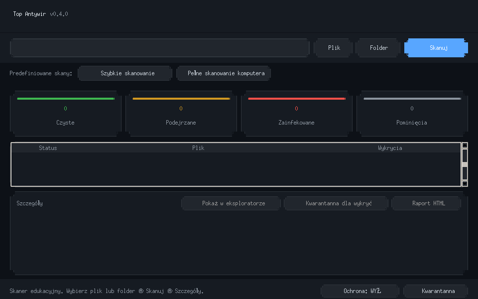
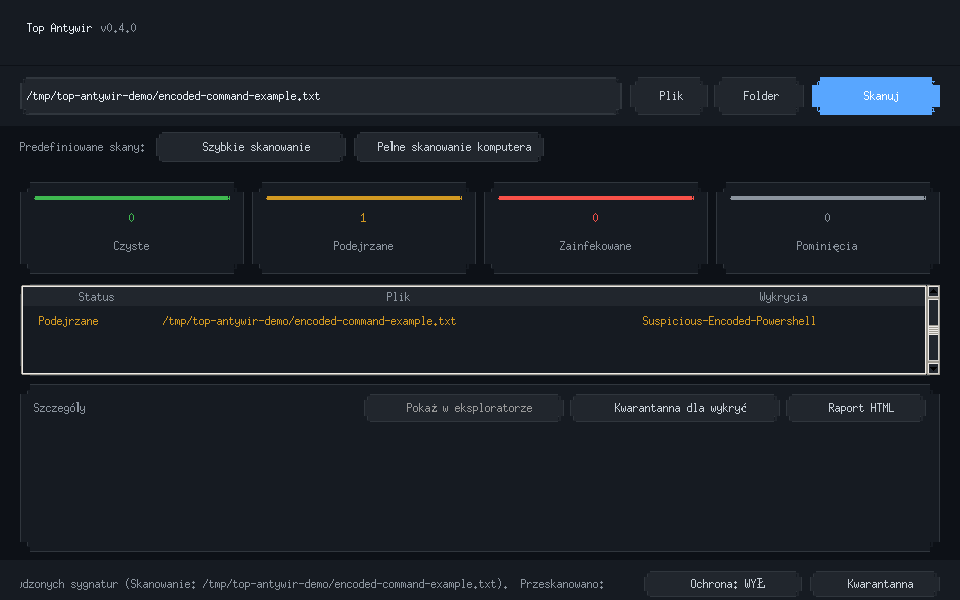

# Top Antywir

> **Educational prototype only. This is not a real antivirus and cannot
> reliably detect or stop malware. Do not use it to protect a computer or
> scan files you cannot afford to lose.**

[](https://github.com/Pawel123j/top-antywir/actions/workflows/ci.yml)

Top Antywir is a Python file-scanning demo with a command-line interface and a
CustomTkinter desktop UI. It demonstrates local hash and pattern matching,
scan reporting, signature-pack validation, audit logging, and a recoverable
quarantine. Signatures are small and manually maintained; the project does not
provide production malware protection.

## Screenshots

Both images are from the running Linux GUI. The second scans a plain-text
fixture containing an inert pattern example; no command in that file is run.





More detail and a repeatable capture command are in
[docs/screenshots/README.md](docs/screenshots/README.md).

## Features

- Scan a file or directory, common locations, or the full filesystem.
- Stream progress and report clean, suspicious, infected, skipped, and failed
  paths. A scan with errors is marked incomplete.
- Review findings, export HTML, and move detections to local quarantine.
- Restore quarantined files to a new or original path; metadata and payloads
  are written so interrupted operations can be recovered.
- Validate JSON packs of hashes and regular expressions before installation.
- Monitor selected directories from user space and schedule scans through the
  platform scheduler.

The scanner skips symlinks and configured exclusions and reports those paths.
It does not inspect archives or execute files. Detection results only describe
the bundled or manually installed signatures that were checked.

## Install

Python 3.10 or newer is required. Tk must be available for the desktop window.

```bash
python -m venv .venv
source .venv/bin/activate
python -m pip install -e '.[dev]'
top-antywir-gui
```

On Debian, Ubuntu, or Kali, install `python3-tk` if Tk is missing. On Windows,
activate the environment with `.venv\Scripts\Activate.ps1`; on macOS, use a
Python build that includes Tk.

## Run a safe demo

This creates an inert text file so the sample pattern can be observed. It does
not create or run a program:

```bash
cat > /tmp/top-antywir-demo.txt <<'EOF'
Static text used to demonstrate signature matching. Never execute this file.
powershell.exe -EncodedCommand NOT_EXECUTED_DEMO_VALUE
EOF

top-antywir scan /tmp/top-antywir-demo.txt --json --html /tmp/top-antywir-report.html
```

The example produces a `Suspicious-Encoded-Powershell` match. Exit codes are
`0` for clean, `1` for suspicious results or scan errors, and `2` for an
infected result.

## CLI and GUI

```text
top-antywir scan PATH [--json] [--html REPORT.html] [--quarantine]
top-antywir scan --quick
top-antywir scan --full
top-antywir monitor PATH [--once] [--quarantine]
top-antywir signatures import PACK.json
top-antywir quarantine list|restore|delete
top-antywir audit --json
```

The GUI flow is choose a file or folder, scan it, then select a result to view
details. It also has Quick and Full presets, cancellation, HTML export, a
user-space monitor toggle, and quarantine management. Full scans can take a
long time; review the selected target before starting one.

On Linux, application data follows XDG locations. On macOS it uses Application
Support and Logs; on Windows it uses LocalAppData. Signature packs, quarantine
payloads, and the audit log are kept in the application data directories.

## Development

```bash
python -m pip install -e '.[dev]'
python -m pytest
ruff check .
```

Build a wheel with `python -m pip wheel --no-deps .`. To build a local
PyInstaller executable, install the `build` extra with
`python -m pip install -e '.[build]'`, then use the platform packaging workflow.
PyInstaller builds are platform-specific.

The CI workflow tests Linux, Windows, and macOS and builds platform-specific
executables. A CI result or a local Linux run does not validate another OS.
Scheduling and long-running monitor behavior depend on each platform's
services and need separate checks.

## Current local validation

- All 87 Python tests, including the Tk GUI test, pass under Xvfb on Linux.
  Without a display, 86 pass and the GUI test is skipped. Ruff passes.
- The GUI was launched under Xvfb and captured in idle and detection states.
- The CLI scanned the harmless text fixture, reported the expected pattern,
  and wrote an HTML report.
- A `py3-none-any` wheel was built locally. This checkout was not packaged into
  a PyInstaller executable, and Windows/macOS were not run.

These checks exercise the demo paths. They do not measure detection quality or
provide evidence that the application can replace antivirus software.

Design and file formats: [architecture](docs/ARCHITECTURE.md),
[signature packs](docs/SIGNATURE-PACKS.md), and
[example pack](examples/example-pack.json).

MIT — see [LICENSE](LICENSE).
